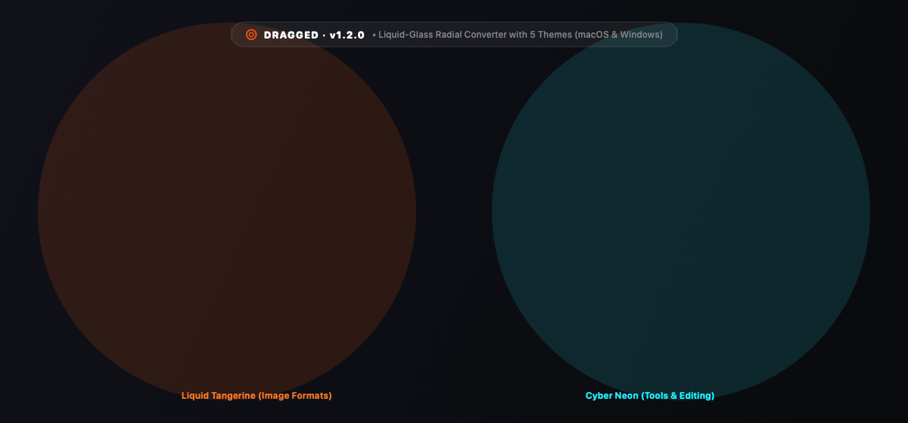

# 🎯 Dragged

> **The ultra-fast, gesture-based local file converter & radial tool wheel for macOS and Windows.**  
> Hold **Shift** while dragging any file, pick an action on the blooming radial wheel, and release. 100% offline, zero cloud uploads.

[](https://github.com/ozertugrul/Dragged/releases)
[%20%7C%20Windows%20x64-blue?style=flat-square)](https://github.com/ozertugrul/Dragged/releases)
[](LICENSE)

<p align="center">
  
</p>

---

## 🎨 5 Liquid-Glass Themes

Switch themes on the fly from the **Menu Bar / System Tray icon** or **Preferences (`Cmd + ,`)**:

| Theme | Finish & Palette | Mood & Contrast |
| :--- | :--- | :--- |
| 🍊 **Liquid Tangerine** *(Default)* | Warm ivory frosted glass, amber & citrus bloom (`#FA6C1E`) | Classic, high clarity, inviting |
| ⚡ **Cyber Neon** | Translucent midnight glass, electric cyan & neon blue glow (`#00F2FE`) | Futuristic dark mode, high contrast |
| 🌲 **Emerald Forest** | Frosted sage glass, rich mint & deep jade glow (`#10B981`) | Organic, calm, focus-friendly |
| 🌑 **Midnight Obsidian** | Deep black obsidian glass, pure silver & monochrome rim | Minimalist, ultra-clean, stealth |
| 🌸 **Sunset Rose** | Frosted rose quartz glass, vivid magenta & coral sunset glow (`#F43F5E`) | Vibrant, warm, expressive |

---

## ✨ Features

- **🎯 Blooming Radial Wheel:** Drag any file in Finder or File Explorer, hold **Shift**, and a beautiful frosted-glass radial wheel blooms directly at your cursor.
- **🔄 Scroll or Tab to Switch Menus:** Use your mouse scroll wheel, trackpad two-finger swipe, or tap **Shift / Tab** while dragging to cycle smoothly between 4 dedicated tool wheels:
  1. **Image Formats:** `PNG`, `WEBP`, `HEIC`, `GIF`, `AVIF`, `BMP`, `PDF`, `DOCX`, Center: `TIFF`
  2. **Tools & Edit:** `COMPRESS`, `METADATA` (EXIF Strip), `EDIT`, `ANNOTATE`, `REMOVE BG`, `PREVIEW`, `CROP`, `REDACT`, Center: `ADD BG`
  3. **Video & Audio:** `MP4`, `GIF`, `MP3` (Audio extractor), `WAV`, `MOV`, `WEBM`, `M4A`, `COMPRESS`, Center: `MUTE`
  4. **PDF & Documents:** `TO PDF`, `COMPRESS`, `SPLIT`, `MERGE`, `OCR TEXT`, `TO IMAGES`, `TO WORD`, `PRINT`, Center: `PREVIEW`
- **💡 Dynamic Slice Hints:** Hovering over any slice shows a center description (e.g. `PNG → Lossless · transparency`, `COMPRESS → Shrink file size`, `METADATA → Strip GPS & EXIF`).
- **🔔 Interactive Notifications with Undo:**
  - Shows file size reduction statistics: `photo.webp · 2.4 MB → 610 KB (75% smaller)`
  - **Open**: Opens the converted file in the default viewer.
  - **Show in Finder / Explorer**: Highlights the file in its folder.
  - **Undo**: Instantly moves the newly created file to Trash / Recycle Bin if you change your mind!
- **🖼️ Real-Time Document Thumbnail Hover:** When dragging images or PDFs, a live mini preview of your file blooms inside the hover petal.
- **🔒 100% Local & Offline:** Never uploads your files to any external server. Uses native high-performance engines (`sips`, `cwebp`, `ffmpeg`, `PDFKit`, `Pillow`).
- **⚡ Universal Binary:** Native support for both **Apple Silicon (M1/M2/M3/M4)** and **Intel** Macs, plus **Windows x64**.

---

## 🚀 Downloads (Latest Release v1.2.0)

| Platform | Type | File | Description |
| :--- | :--- | :--- | :--- |
| **macOS** | **DMG Installer** | [`Dragged-macOS-Universal.dmg`](https://github.com/ozertugrul/Dragged/releases/download/v1.2.0/Dragged-macOS-Universal.dmg) | Universal binary for Apple Silicon & Intel |
| **macOS** | **ZIP Archive** | [`Dragged-macOS-Universal.zip`](https://github.com/ozertugrul/Dragged/releases/download/v1.2.0/Dragged-macOS-Universal.zip) | Portable app bundle |
| **Windows** | **Setup Installer** | [`Dragged-Setup-Windows-x64.exe`](https://github.com/ozertugrul/Dragged/releases/download/v1.2.0/Dragged-Setup-Windows-x64.exe) | Complete setup wizard with shortcuts |
| **Windows** | **Standalone Exe** | [`Dragged.exe`](https://github.com/ozertugrul/Dragged/releases/download/v1.2.0/Dragged.exe) | Single portable executable |

---

## 📋 Changelog (v1.2.0)

- **New Theme Engine:** Added 5 distinct liquid-glass finishes (Liquid Tangerine, Cyber Neon, Emerald Forest, Midnight Obsidian, Sunset Rose).
- **Theme Switcher:** Switch themes anytime directly from the Menu Bar / Tray menu or Preferences (`Cmd + ,`).
- **Interactive Notifications:** Added native `Undo` (moves generated file to Trash), `Open`, and `Show in Finder` actions.
- **Dynamic Center Hints:** Hovering over petals dynamically displays slice format capabilities and usage tips in the center hub.
- **No More Clipping:** Enlarged radial canvas to 440px and placed category headers with comfortable breathing room.
- **Real App Showcase Banner:** Replaced placeholder artwork with pixel-perfect native rendering of Dragged's actual UI.

---

## 🛠️ Building from Source

### macOS (Apple Silicon + Intel Universal)
Requirements: macOS 13+, Apple Xcode Command Line Tools.

```bash
git clone https://github.com/ozertugrul/Dragged.git
cd Dragged
chmod +x build.sh
./build.sh
```
The compiled Universal binary and `.dmg` will be placed in `release/`.

### Windows (x64)
Requirements: Python 3.10+, Inno Setup 6 (optional, for installer).

```cmd
git clone https://github.com/ozertugrul/Dragged.git
cd Dragged\windows
pip install -r requirements.txt
build_windows.bat
```

---

## 📄 License

Distributed under the [MIT License](LICENSE).
